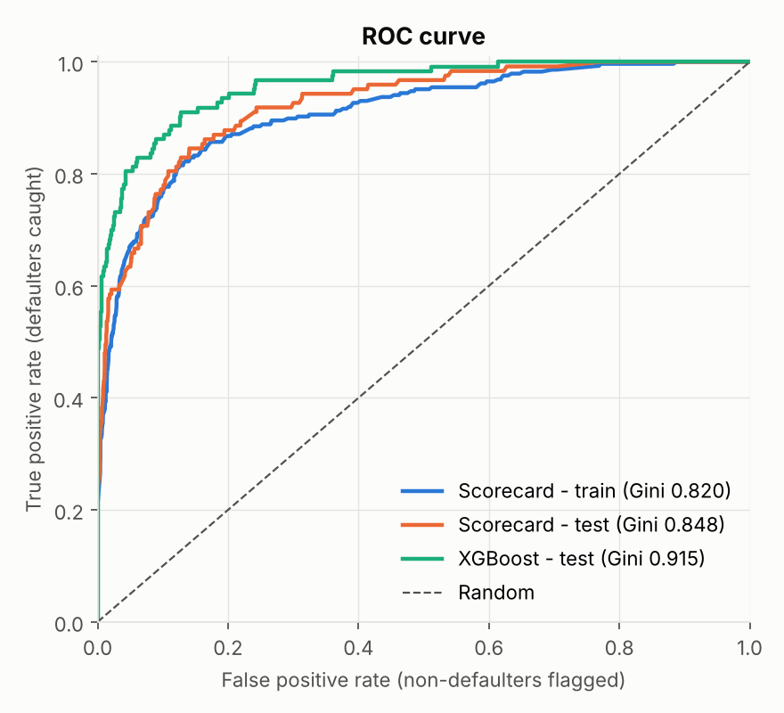
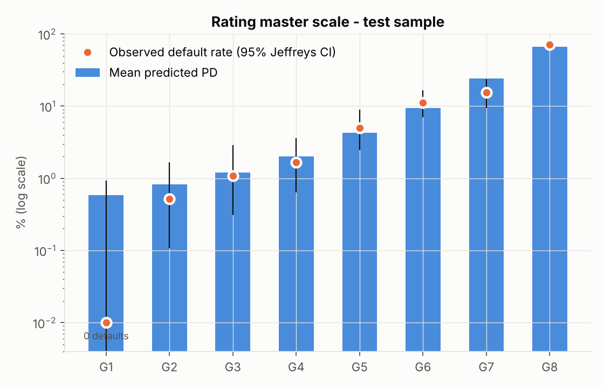
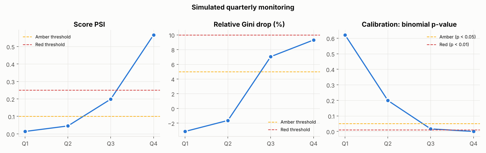

# Corporate PD Model & Monitoring Framework

A 1-year **probability of default (PD) scorecard** for corporate borrowers, built the way a bank
credit-risk modelling team would build one: SQL data preparation, Weight-of-Evidence binning, a
documented variable-selection funnel, logistic regression, a points scorecard, an 8-grade rating
master scale, an XGBoost challenger, and a quarterly **monitoring framework** (PSI / CSI / Gini
decay / binomial calibration test) with an automated RAG Excel report.

📄 **[Model development document](docs/model_development_document.md)** &nbsp;|&nbsp;
📓 **[Step-by-step notebook](notebooks/01_pd_model_walkthrough.ipynb)** &nbsp;|&nbsp;
📊 **[Monitoring report (Excel)](reports/monitoring_report.xlsx)**

---

## Results at a glance

| Hold-out sample (1,773 firms, 123 defaults) | |
|---|---|
| **Gini** | **0.848** (95% CI 0.795 - 0.893) |
| AUC / KS | 0.924 / 0.705 |
| Calibration | Hosmer-Lemeshow p = 0.80; mean PD 7.15% vs observed 6.94% |
| Model size | **4 variables** selected from 64 financial ratios (all VIF < 1.5) |
| Master scale | 8 grades, monotonic default rates on train and test |
| XGBoost challenger | Gini 0.915 on 64 inputs (train Gini 0.995, so it over-fits); kept as benchmark |

<p align="center">
   
</p>

### Final model: four ratios, four risk dimensions

| Variable | Ratio | Risk dimension | Coefficient (WoE) |
|---|---|---|---|
| Attr21 | sales (n) / sales (n−1) | Growth / momentum | −0.744 |
| Attr27 | operating profit / financial expenses | Interest cover | −0.732 |
| Attr46 | (current assets − inventory) / short-term liabilities | Liquidity | −0.515 |
| Attr38 | constant capital / total assets | Capital structure | −0.386 |

### Monitoring: simulated quarters

| Quarter | Scenario | PSI | Gini | Binomial p | Status |
|---|---|---|---|---|---|
| Q1 | Business as usual | 0.014 | 0.875 | 0.62 | 🟢 Green |
| Q2 | Mild deterioration | 0.045 | 0.862 | 0.20 | 🟢 Green |
| Q3 | Moderate downturn | 0.199 | 0.788 | 0.016 | 🟠 Amber |
| Q4 | Severe stress | 0.567 | 0.769 | < 0.001 | 🔴 Red |



---

## Pipeline

```
data/raw/5year.arff
   │
   ▼  sql/feature_engineering.sql (DuckDB)
   │    unpivot → profile on train → drop >20% missing → winsorise 1%/99% → missing-count feature
   ▼
WoE binning (monotonic, min 5% per bin, missing = own bin)  →  IV
   ▼
Selection funnel: IV ≥ 0.02 → |corr| ≤ 0.7 → VIF ≤ 5 → forward stepwise (sign + p < 0.05)
   │    64 → 63 → 29 → 29 → 4
   ▼
Logistic regression  →  PD  →  points scorecard (600 @ 50:1, PDO 20)  →  8-grade master scale
   ▼
Validation: AUC, Gini (bootstrap CI), KS, Hosmer-Lemeshow, binomial & Jeffreys tests, XGBoost benchmark
   ▼
Monitoring: PSI, CSI, Gini decay, calibration → RAG → reports/monitoring_report.xlsx
```

## Repository structure

```
├── run_pipeline.py              # end-to-end run: rebuilds everything in reports/
├── sql/feature_engineering.sql  # data preparation in DuckDB
├── src/pdmodel/
│   ├── config.py                # every modelling choice and threshold in one place
│   ├── data.py                  # load ARFF, stratified split, run SQL
│   ├── woe.py                   # monotonic WoE binning + IV
│   ├── selection.py             # IV → correlation → VIF → stepwise funnel (with drop log)
│   ├── scorecard.py             # logistic model, points table, XGBoost challenger
│   ├── validation.py            # Gini, KS, AUC, HL, binomial, Jeffreys, bootstrap CI
│   ├── master_scale.py          # rating grades and grade-level calibration
│   ├── monitoring.py            # PSI, CSI, drift simulation, RAG logic
│   ├── report_excel.py          # formatted Excel monitoring report
│   └── plots.py                 # charts
├── notebooks/01_pd_model_walkthrough.ipynb
├── docs/model_development_document.md
├── reports/                     # generated tables, figures, metrics.json, Excel report
└── data/raw/                    # source data + ratio definitions
```

## Run it

```bash
git clone https://github.com/Ajayvir37/corporate-pd-model.git
cd corporate-pd-model
pip install -r requirements.txt
python run_pipeline.py
```

## Key design decisions

- **1-year horizon file (`5year.arff`)**: Basel IRB PDs are defined over one year.
- **No test-set leakage**: missing-value thresholds, winsorisation caps, WoE bins and master-scale
  bands are all estimated on the training sample only.
- **WoE + logistic regression over a black box**: XGBoost ranks better, but a 4-variable scorecard
  is transparent, stable and explainable to credit officers and validators.
- **Missing values as information**: missing ratios get their own WoE bin. A sensitivity test
  shows hold-out Gini is still 0.791 without firms missing sales growth.

## Limitations

The sample default rate (6.9%) is not a long-run portfolio average, so PDs would need recalibration
before use. There is no out-of-time sample, and the monitoring quarters are simulated. The full list
is in the [model document](docs/model_development_document.md#10-limitations).

## Data

Tomczak, S. (2016). *Polish Companies Bankruptcy*. UCI Machine Learning Repository, licensed
[CC BY 4.0](https://creativecommons.org/licenses/by/4.0/).
[Dataset page](https://archive.ics.uci.edu/dataset/365/polish+companies+bankruptcy+data).
