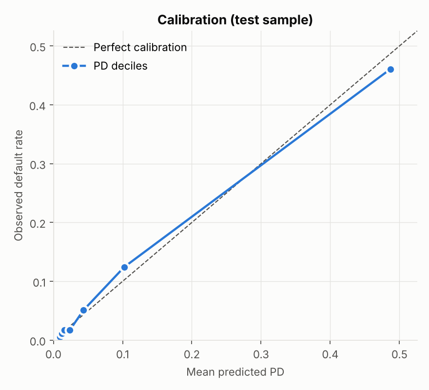

# Model Development Document
## Corporate 1-Year Probability of Default (PD) Scorecard

| | |
|---|---|
| **Model type** | Logistic regression on Weight-of-Evidence (WoE) transformed financial ratios |
| **Portfolio** | Corporate borrowers (illustrative: Polish manufacturing companies) |
| **Output** | 1-year PD, points score and 8-grade rating |
| **Author** | Ajayvir Singh |
| **Version** | 1.0 |
| **Code** | `run_pipeline.py`, `src/pdmodel/`, `sql/feature_engineering.sql` |

> This is a portfolio project built on public data. It follows the structure and standards of
> bank model documentation, but it is not a production model.

---

## 1. Executive summary

A 1-year PD model was developed for corporate borrowers using 64 financial ratios from 5,910
companies (410 defaults, 6.9% default rate). After SQL-based data preparation, WoE binning and a
four-stage selection funnel, the final model uses **four ratios**, each covering a different
dimension of credit risk: sales growth, interest cover, liquidity and capital structure.

| Metric (hold-out sample, 1,773 firms) | Value |
|---|---|
| AUC | 0.924 |
| Gini | 0.848 (95% bootstrap CI 0.795 - 0.893) |
| KS | 0.705 |
| Hosmer-Lemeshow p-value | 0.80 (no evidence of mis-calibration) |
| Mean PD vs observed default rate | 7.15% vs 6.94% |
| Top-decile default capture | 66.7% of defaults in the riskiest 10% of firms |

PDs are mapped to an 8-grade master scale whose default rates rise monotonically on both the
development and hold-out samples. An XGBoost challenger reaches a hold-out Gini of 0.915 but is
not adopted, for interpretability and stability reasons (Section 7). A monitoring framework (PSI,
CSI, Gini decay, binomial calibration test, RAG status, Excel report) is specified and demonstrated
on simulated quarters (Section 9).

---

## 2. Purpose and scope

- **Use:** estimate the probability that a corporate borrower defaults within 12 months, to support
  credit approval, rating assignment and risk-based pricing.
- **Horizon:** 1 year, consistent with the Basel IRB definition of PD.
- **Default definition:** bankruptcy within the year following the financial statements (as defined
  in the source data). A bank model would use the Basel definition (90 days past due or unlikely to pay).
- **Out of scope:** LGD and EAD; financial institutions and sovereigns; through-the-cycle
  calibration (Section 10).

---

## 3. Data

### 3.1 Source
UCI Machine Learning Repository - *Polish Companies Bankruptcy* (Tomczak, 2016), CC BY 4.0. Data from
the Emerging Markets Information Service: bankrupt companies analysed over 2000-2012, operating
companies over 2007-2013. The file `5year.arff` contains statements from the 5th year of the
window, labelled with bankruptcy status one year later - the 1-year horizon.

### 3.2 Sample

| Sample | Firms | Defaults | Default rate |
|---|---|---|---|
| Development (train, 70%) | 4,137 | 287 | 6.94% |
| Hold-out (test, 30%) | 1,773 | 123 | 6.94% |
| **Total** | **5,910** | **410** | **6.94%** |

The split is stratified on the default flag (seed 42). The data has no reliable date per firm, so
an out-of-time sample could not be built (Section 10).

### 3.3 Data preparation (SQL, DuckDB)
`sql/feature_engineering.sql` performs all preparation. Every threshold is estimated **on the
training sample only** and then applied to all samples, so no test information leaks into the model.

1. Unpivot the 64 ratios to long format and profile each one (missing rate, 1st/99th percentiles, raw min/max).
2. **Exclude** ratios with more than 20% missing values: only `Attr37` (43% missing) is dropped.
3. **Winsorise** each remaining ratio at its training 1st and 99th percentiles. Raw ratios are extremely
   heavy-tailed (e.g. `Attr5` ranges from -1.08 million to 1.25 million) because denominators can be near zero.
4. Missing values are **kept as missing**. They receive their own WoE bin (Section 4), because missingness
   is itself informative.
5. Add a data-quality feature, `n_missing_ratios` (number of missing ratios per firm).

This gives **64 candidate variables** (63 ratios + `n_missing_ratios`).

---

## 4. Methodology

### 4.1 WoE binning
For each candidate:
1. 10 quantile pre-bins on non-missing values;
2. merge bins holding fewer than 5% of firms;
3. merge adjacent bins until the default rate is **monotonic** across bins (business intuition, stability);
4. missing values form their own bin if there are at least 30 of them; otherwise they get the WoE of
   the riskiest bin (conservative).

WoE = ln(% non-defaulters / % defaulters) per bin, with 0.5 smoothing to avoid empty cells.
Information Value IV = Σ (% non-defaulters − % defaulters) × WoE.

### 4.2 Why WoE + logistic regression
- WoE makes each ratio's relationship with log-odds linear, which logistic regression assumes.
- Outliers and missing values are handled inside the binning; no imputation is needed.
- Coefficients and bin-level points can be explained to credit officers and validators.
- Logistic regression is the industry standard for PD scorecards and is well understood by regulators.

---

## 5. Variable selection

| Stage | Rule | Variables remaining |
|---|---|---|
| Candidates | | 64 |
| 1. IV filter | IV ≥ 0.02 | 63 |
| 2. Correlation filter | drop if \|corr\| > 0.7 with a higher-IV variable already kept | 29 |
| 3. VIF filter | VIF ≤ 5 | 29 |
| 4. Forward stepwise | enter only if all coefficients are negative and p < 0.05 | **4** |

The full log, including why each variable was dropped, is in `reports/selection_funnel.csv`.

**Observations**
- Many IVs exceed 0.5, the conventional "check for leakage" level. Over a 1-year horizon distressed
  firms already show collapsing sales and losses in their last statements, so the strength is
  plausible. It is still recorded as a limitation, because performance should be expected to fall
  at longer horizons or in less distressed portfolios.
- The correlation filter removed 34 variables. Most of them share profitability numerators (gross
  profit, net profit, EBIT) and are close substitutes for each other.
- After four variables, no remaining candidate was significant with the expected sign: profitability
  information was already captured through `Attr27`.

### 5.1 Final variables

| Variable | Definition | Risk dimension | IV | VIF |
|---|---|---|---|---|
| Attr21 | sales (n) / sales (n−1) | Growth / momentum | 2.11 | 1.16 |
| Attr27 | profit on operating activities / financial expenses | Interest cover | 1.72 | 1.18 |
| Attr46 | (current assets − inventory) / short-term liabilities | Liquidity (quick ratio) | 0.89 | 1.43 |
| Attr38 | constant capital / total assets | Capital structure | 0.69 | 1.40 |

All VIFs are below 1.5, so multicollinearity is negligible.

---

## 6. Final model

### 6.1 Coefficients (development sample)

| Term | Coefficient | Std. error | z | p-value |
|---|---|---|---|---|
| Intercept | −2.649 | 0.088 | −30.15 | < 0.001 |
| Attr21 (WoE) | −0.744 | 0.056 | −13.36 | < 0.001 |
| Attr27 (WoE) | −0.732 | 0.056 | −13.00 | < 0.001 |
| Attr46 (WoE) | −0.515 | 0.090 | −5.73 | < 0.001 |
| Attr38 (WoE) | −0.386 | 0.103 | −3.74 | < 0.001 |

All signs are negative as expected (higher WoE = safer = lower PD), and all terms are significant at 0.1%.

### 6.2 Points scorecard
Score = 600 at 50:1 odds of non-default, with 20 points to double the odds (Factor = 28.85,
Offset = 487.12). The full points table is in `reports/scorecard_points.csv`. Example for interest cover (`Attr27`):

| Bin | Firms | Default rate | Points |
|---|---|---|---|
| < −0.80 | 389 | 30.8% | 103 |
| −0.80 to 0 | 224 | 4.9% | 148 |
| ≥ 0 | 3,271 | 2.3% | 165 |
| Missing | 253 | 32.0% | 102 |

### 6.3 Key bin patterns
- **Sales growth (`Attr21`):** firms whose sales fell by more than about 16% default at 22.6%, against
  2.2% for firms growing by more than 17%.
- **Missing `Attr21`:** 66 development firms have no prior-year sales figure, and 97% of them default.
  This is a strong signal but probably a data-collection artefact, so it is sensitivity-tested in Section 7.3.
- **Missing `Attr27`:** 253 firms; 32% default rate.

---

## 7. Model performance

### 7.1 Discrimination and calibration

| Metric | Development | Hold-out |
|---|---|---|
| Firms / defaults | 4,137 / 287 | 1,773 / 123 |
| AUC | 0.910 | 0.924 |
| Gini | 0.820 (CI 0.775 - 0.855) | 0.848 (CI 0.795 - 0.893) |
| KS | 0.690 | 0.705 |
| Brier score | 0.040 | 0.038 |
| Mean PD / observed DR | 6.94% / 6.94% | 7.15% / 6.94% |
| Hosmer-Lemeshow p | 0.136 | 0.798 |
| Binomial test p (portfolio) | 0.51 | 0.65 |

The slightly higher hold-out Gini is within sampling error: the bootstrap intervals overlap almost
entirely. There is no evidence of over-fitting, and calibration is acceptable on both samples.




### 7.2 Benchmark: XGBoost challenger

| | Inputs | Gini train | Gini hold-out |
|---|---|---|---|
| WoE scorecard (champion) | 4 | 0.820 | 0.848 |
| XGBoost (challenger) | 64 | 0.995 | 0.915 |

XGBoost ranks better by about 7 Gini points, but it uses 16 times more inputs, shows a large
train/hold-out gap (over-fitting risk) and cannot be explained bin by bin. Given model-risk
expectations for transparency and stability (e.g. SR 11-7), the scorecard is retained as champion.
The gap is a useful signal: non-linear interactions between ratios could be explored in a future
version (Section 11).

### 7.3 Sensitivity: missing sales growth
Excluding the 37 hold-out firms with a missing `Attr21`, the hold-out Gini is **0.791**, against 0.848
for all firms. The model remains strong without the missing-value signal, but part of its measured
power comes from it. In production, missing sales history should trigger a data-quality review
rather than relying on the model alone.

---

## 8. Rating master scale

PDs are mapped to 8 grades using fixed PD bands chosen on the development sample, so that every
grade is populated and default rates rise monotonically.

| Grade | PD band | Hold-out firms | Share | Mean PD | Observed DR | 95% Jeffreys CI | Binomial p |
|---|---|---|---|---|---|---|---|
| G1 | < 0.65% | 270 | 15.2% | 0.58% | 0.00% | 0.00 - 0.93% | 1.00 |
| G2 | 0.65 - 1.0% | 386 | 21.8% | 0.82% | 0.52% | 0.11 - 1.65% | 0.82 |
| G3 | 1.0 - 1.5% | 276 | 15.6% | 1.21% | 1.09% | 0.31 - 2.87% | 0.65 |
| G4 | 1.5 - 3.0% | 302 | 17.0% | 2.02% | 1.66% | 0.63 - 3.59% | 0.73 |
| G5 | 3.0 - 6.0% | 181 | 10.2% | 4.25% | 4.97% | 2.49 - 8.88% | 0.36 |
| G6 | 6.0 - 15% | 162 | 9.1% | 9.42% | 11.11% | 6.96 - 16.63% | 0.27 |
| G7 | 15 - 35% | 97 | 5.5% | 24.12% | 15.46% | 9.33 - 23.63% | 0.99 |
| G8 | ≥ 35% | 99 | 5.6% | 66.98% | 71.72% | 62.31 - 79.87% | 0.19 |

- Default rates are **monotonic** on both the development and hold-out samples.
- No grade shows a significant **under**-estimation of risk (all one-sided binomial p > 0.05).
  G7 is conservative: its observed rate is below its PD.


---

## 9. Monitoring framework

### 9.1 Metrics and thresholds

| Metric | What it detects | Green | Amber | Red |
|---|---|---|---|---|
| Score PSI (vs development deciles) | Population shift | < 0.10 | 0.10 - 0.25 | > 0.25 |
| CSI per model variable | Which input is shifting | (diagnostic) | | |
| Relative Gini drop vs development | Loss of ranking power | < 5% | 5 - 10% | > 10% |
| One-sided binomial test, observed DR vs mean PD | Under-estimation of PD | p ≥ 0.05 | 0.01 - 0.05 | p < 0.01 |

The overall status is the worst of the three. Amber triggers investigation; Red triggers escalation
to model governance (recalibration or redevelopment).

### 9.2 Demonstration on simulated quarters
No post-development data exists, so four quarters were simulated from the hold-out sample:
- **risk tilt:** resampling toward higher-risk firms, so the portfolio mix worsens;
- **ratio noise:** Gaussian noise proportional to each ratio's interquartile range, so the financials become less informative;
- **default uplift:** extra defaults beyond the model PD, representing a downturn not yet visible in the ratios.

| Quarter | Scenario | Observed DR | Mean PD | PSI | Max CSI | Gini | Gini drop | Binomial p | Overall |
|---|---|---|---|---|---|---|---|---|---|
| Q1 | Business as usual | 7.2% | 7.4% | 0.014 | 0.008 | 0.875 | −3.1% | 0.62 | 🟢 Green |
| Q2 | Mild deterioration | 9.9% | 9.3% | 0.045 | 0.074 | 0.862 | −1.6% | 0.20 | 🟢 Green |
| Q3 | Moderate downturn | 14.1% | 12.4% | 0.199 | 0.185 | 0.788 | 7.0% | 0.016 | 🟠 Amber |
| Q4 | Severe stress | 23.6% | 19.0% | 0.567 | 0.409 | 0.769 | 9.3% | < 0.001 | 🔴 Red |

The framework escalates as intended. In Q4 the PSI and calibration tests are Red: the PD level no
longer matches observed defaults, so a recalibration would be required. CSI attributes most of the
shift to interest cover (`Attr27`). The quarterly report with RAG formatting is
`reports/monitoring_report.xlsx`.


---

## 10. Limitations

1. **Sample default rate:** the 6.9% default rate reflects how the sample was constructed, not a real
   portfolio's long-run average. Before use, PDs would be recalibrated to the portfolio's central tendency.
2. **No out-of-time validation:** firm-level dates are not available, so validation is out-of-sample only.
3. **Point-in-time, single economy:** the data comes from one country and period. Through-the-cycle
   calibration and margins of conservatism (as required under Basel IRB) are not applied.
4. **Very high IVs:** with a 1-year horizon, distress is already visible in the statements. Performance
   at longer horizons or in healthier portfolios would be lower.
5. **Missing-value signals:** missing `Attr21` and `Attr27` carry strong default signals that may be
   data-collection artefacts (Section 7.3).
6. **Simulated monitoring:** the Section 9 results demonstrate that the framework works; they are not
   evidence of model stability.
7. **Financial ratios only:** there are no qualitative factors (management, industry, country risk) and
   no market data, unlike a full bank rating model.

## 11. Possible next steps
- Recalibrate PDs to a long-run default rate and add a margin of conservatism.
- Out-of-time validation using the other horizon files or dated data.
- Add a qualitative overlay (industry, management quality) as in bank corporate rating tools.
- Explore interaction terms suggested by the XGBoost challenger, keeping the model interpretable.
- Extend to LGD/EAD for expected loss (EL = PD × LGD × EAD).

## 12. Reproducibility
```bash
pip install -r requirements.txt
python run_pipeline.py        # rebuilds every table, chart and report in reports/
```
All randomness uses seed 42. Every figure in this document comes from `reports/metrics.json` and
the CSV tables in `reports/`.

## Reference
Tomczak, S. (2016). *Polish Companies Bankruptcy* [Dataset]. UCI Machine Learning Repository.
https://archive.ics.uci.edu/dataset/365/polish+companies+bankruptcy+data (CC BY 4.0)
